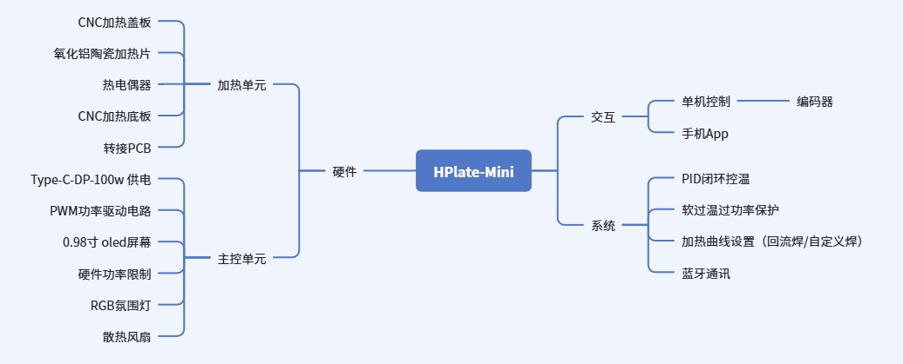
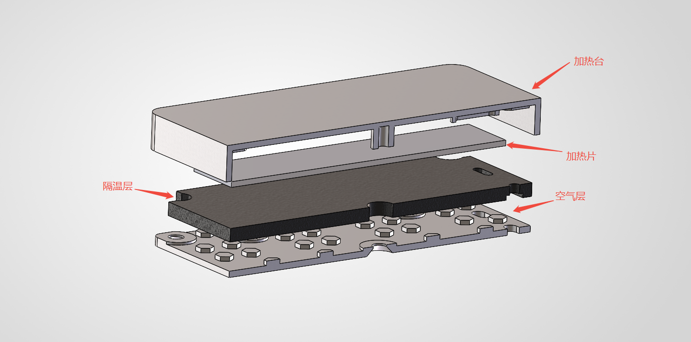
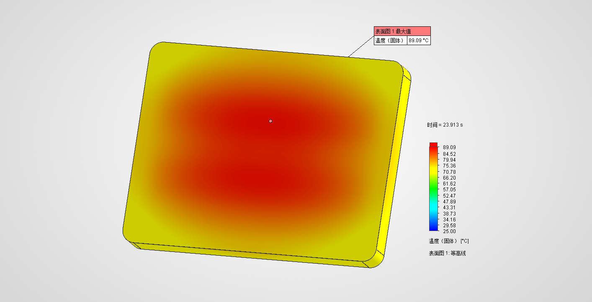

+++
author = "张小橙"
title = '一款小型加热台 HPlate-Mini'
date = '2026-09-21T15:55:13+08:00'
draft = false
description = "用最少的成本做一台闭环控温的小型加热台：6061 铝合金平台、陶瓷加热片与热力学仿真，有效加热面积近乎翻倍。"
tags = ["硬件", "DIY", "PCB", "热力学"]
keywords = ["加热台", "HPlate", "6061 铝合金", "陶瓷加热片", "立创EDA"]

[cover]
image = "/images/cover-hplate.webp"
alt = "HPlate-Mini 小型加热台"
caption = ""
relative = false
hiddenInList = false
hiddenInSingle = true
+++

## 项目起源
现在焊接一直用鹿仙子铁板烧，最近有一次忘记关电源导致空载了好久有点后怕，所以想要换一台有控的，但是线上卖的小型加热台太贵了，所以本次项目就是用最少的成本制作一个精致小巧加热台。（打算用充电头供电 100W 这样子，做大了功率也不支持）

> **想要实现的炫酷吊炸天的效果**
>
> - ~~交流电~~ ➡ 直流电
> - ~~通电加热~~ ➡ 闭环控温
> - ~~工业简陋风~~ ➡ 炫酷高级风
> - ~~力大砖飞~~ ➡ 极致的导温锁温
> - ~~毫无保护~~ ➡ 无懈可击

## 功能设计

### 起名：HPlate = Hot Plate（发热铁板）

## 硬件开发

### 加热单元

平台使用了 6061 系铝合金 `因为免费打样只支持这个材料`，热源使用两片 7015 陶瓷加热片 `因为整块加热板需要开模太贵了`，使用云母片实现隔热和固定加热片，背板同样采用 6061 系铝合金，最后沉头螺丝压紧它们，经过层层优化和漫长的热力学仿真，最终把材料和功率都利用到极致，最终平台加热面积相比市售 `50*50mm` 加热台有效面积近乎翻倍工作面积提升近 ~~100%~~ 98.4%，说人话就是做到了 `80*62mm` 这个尺寸吧那肯定是跟免费打样限制 80*80mm 以内是没有关系的纯属巧合！！

