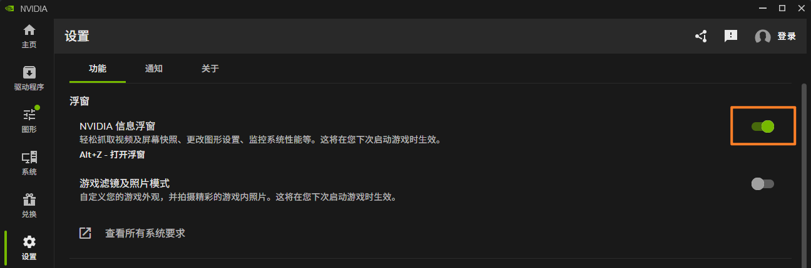
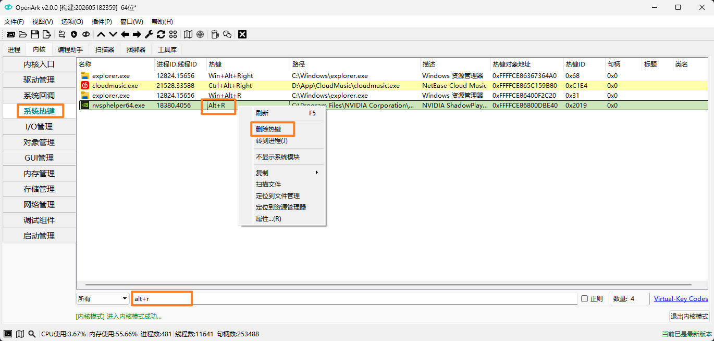

+++
author = "张小橙"
title = '嘉立创EDA快捷键Alt+R冲突问题'
date = '2026-10-05T15:36:37+08:00'
draft = false
description = "嘉立创 EDA 里 Alt+R 矩形快捷键失效，原因是 NVIDIA 驱动信息浮窗抢占热键；用 OpenArk 查出占用程序并关闭即可。"
tags = ["EDA", "Windows", "效率工具"]
keywords = ["嘉立创EDA", "Alt+R", "快捷键冲突", "OpenArk", "NVIDIA"]

[cover]
image = "/images/cover-jlceda.webp"
alt = "嘉立创EDA快捷键冲突排查"
caption = ""
relative = false
hiddenInList = false
hiddenInSingle = true
+++

## 遇到的问题 & 解决方案

画原理图时发现【矩形快捷键 Alt+R】无法使用，排查后发现是 NVIDIA 驱动的信息浮窗占用了这个快捷键，直接在 NVIDIA 软件内关闭信息浮窗即可。

## 问题扩展

可能好奇的同学要问了，我怎么知道是这个软件产生的冲突，授人以鱼不如授人以渔，现在就分享给大家。

> **[OpenArk 软件官网链接](http://openark.blackint3.com:88/)**

打开软件后进入系统热键，搜索你要查询的快捷键，就可以找到占用应用，然后右键删除热键即可。

> ⚠️ **重要提示**
>
> 尽量在软件内部关闭热键。软件更新时有可能自动重置，再次注册抢占快捷键。
