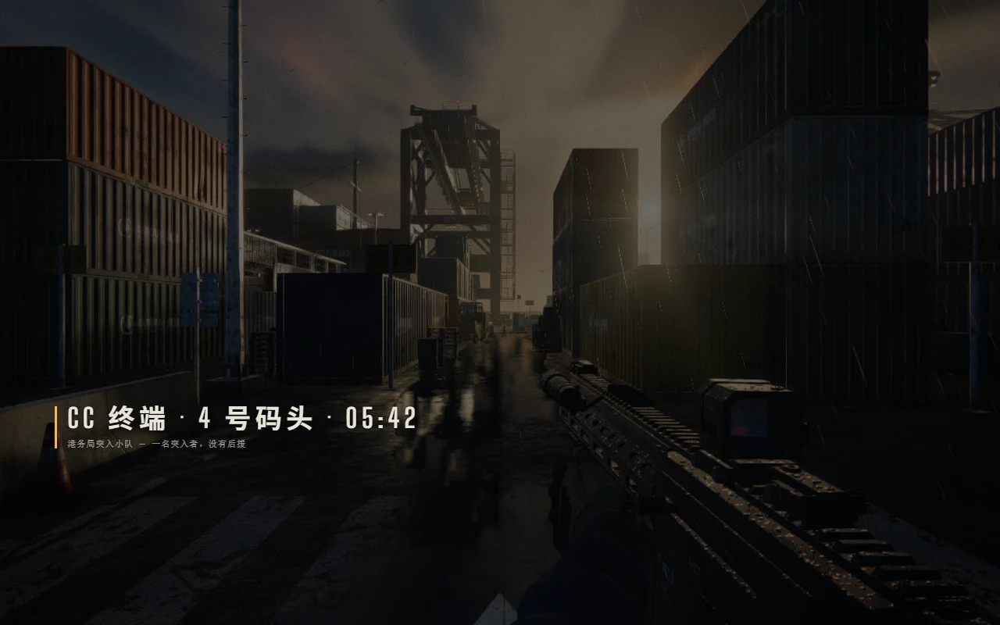

+++
author = "张小橙"
title = '一个 1.4 MB 的 HTML 里装着一整个港口潜入 FPS'
date = '2026-11-12T18:35:00+08:00'
draft = false
description = "一个 1.4 MB 的 HTML 文件，装着一整个雨夜港口：程序化生成的码头、实时合成的音效、完整的第一人称潜入玩法，以及我把它中文化、改名 CC 的过程。"
summary = "1.4 MB 单个 HTML，双击就能玩的港口潜入 FPS：程序化场景、shader 贴图、WebAudio 现场合成音效，外加中文化与改名 CC 的改动记录。"
tags = ["游戏", "WebGL", "three.js", "单文件", "FPS"]
keywords = ["浏览器游戏", "WebGL", "three.js", "FPS", "程序化生成", "单文件"]

[cover]
image = "/images/cover-cc.webp"
alt = "CC 的标题画面：雨夜码头与游戏主菜单"
caption = ""
relative = false
hiddenInList = false
hiddenInSingle = true
+++

一个 **1.4 MB 的 HTML 文件**，双击就能运行，里面是一整个第一人称港口潜入游戏：引擎、场景、贴图、音效、界面全在里面，不请求任何图片、模型或音频资源。游戏叫 **CC**，标题画面就是下面这张图。

<a class="play-game" href="/saltline/" target="_blank" rel="noopener">▶ 在线开玩<small>新窗口打开 · 需要 WebGL2 · 桌面浏览器体验最佳，手机触屏也能玩</small></a>

## 这是什么游戏

港口安保网络「港务长」（Harbormaster）失控，整座 CC 终端都听它的。你作为代号 Breacher 的突入者单人进场，任务只有两个：

1. 切断三个上行中继——堆场（yard）、库房（shed）、码头（quay）；
2. 在船等你之前，跑到码头南端的梯子撤离。

流程很短，压力是一层层叠加的：

- 每切断一个中继，港务长都会察觉，随后派机器过来，切得越多来得越多（场上最多同时 9 台）；
- 三个中继全断之后，船才会靠到南端码头梯，同时追兵一波接一波地追着你打；
- 没切完就想上船，会被提示“中继还在，船不会在火力下等你”。

敌人只有两种：**海鸥**（Gulls）在空中的飞行机器，会俯冲点射；**猎犬**（Hounds）在地面行走，会绕集装箱找你。打完记得换掩体。

中继附近会出现提示环和读条，按住交互键约 2.4 秒即可切断；死亡会进入「信号丢失」结算，可以重试；成功撤离则进入「任务复盘」，记录用时、命中率、击杀数与重试次数。

## 操作

| 动作 | 键鼠 | 触屏 |
| --- | --- | --- |
| 移动 | `W` `A` `S` `D` | 左拇指摇杆 |
| 视角 | 鼠标 | 右半屏拖动 |
| 射击 / 瞄准 | 左键 / 右键 | 射击 / 瞄准 |
| 装填 | `R` | 装填 |
| 切断中继 | 按住 `E`（约 2.4 秒） | 长按 使用 |
| 跳跃 / 冲刺 / 蹲下 | `Space` / `Shift` / `C` 或 `Ctrl` | 跳跃 / 摇杆推到底 |
| 近战 | `F` | — |
| 暂停 | `Esc` 或 `P` | 右上角 |

武器是一把 **PAC-9「长岸」**，弹匣 30、备弹 120；左键全自动，右键开镜。

## 一个文件是怎么做出来的

整个项目最值得看的地方，是它把一整套游戏系统压进了单个 HTML：

- **引擎内联**：`three.js` 直接嵌在 `<script>` 里，约 139 万字符的脚本就是游戏本体，没有任何模块或资源请求；
- **场景全程序化**：码头布局、集装箱堆、编号 `CC 04` 的吊机、名为 `KITTIWAKE` 的货轮、远景天际线，全部由代码生成，没有手工建模文件；
- **贴图与材质全现算**：金属、水泥、水面、雨丝、雾，靠自定义 shader 与 Canvas 在运行时生成；
- **声音全合成**：脚步、枪声与混响尾音、中继的电流嗡鸣、海鸥、雾笛、缆绳敲击、集装箱碰撞，都用 WebAudio 现场合成；两套卷积混响（户外 / 库房），并对近处的敌人和中继做空间音频；
- **动态音乐**：音乐分层随警戒强度变化，被追的时候气氛会明显紧起来；
- **设置持久化**：画质（自动 / 低 / 中等 / 高 / 极高）、灵敏度、Y 轴反转、音量、视野 60–95、全屏，都存在 `localStorage` 里；
- **响应式 UI**：同一套 HUD 与菜单在桌面和手机上都能用，手机自动切出触屏摇杆与按钮。

代价也很明确：单文件 1.4 MB；首次打开要编译 shader、生成世界（软件渲染环境实测约 14 秒，正常显卡上通常是几秒）；必须支持 WebGL2，太老的机器或核显会比较吃力。唯一的外链是三个 Google Fonts（标题用的 Big Shoulders Display 等），断网时回退到系统字体，游戏照常跑；中文文案本身走系统字体，不依赖这些字体。

## 我做了什么

拿到的是英文原版。我在这个版本上做了这些改动，玩法和数值一处没动：

- **全界面中文化**：主菜单、设置、操作说明、HUD、目标提示、无线电台词、死亡与结算页、按键提示，全部翻成中文；
- **标题与前缀改成 CC**：标题屏、浏览器标题、终端名牌、吊机编号、枪械标牌上的 `SALTLINE` 全部换成 `CC`（原版标题为 SALTLINE）；
- **修了一个中文版才会出现的 bug**：原文件没有声明 `<meta charset="utf-8">`——全 ASCII 时毫无影响，但加了中文之后，浏览器会按本地编码去解码 UTF-8 字节，把脚本拆坏，整页直接黑屏（控制台报 `SyntaxError`）。补上 charset 后才恢复正常；
- **补了 `viewport` meta**：没有它时手机会把页面当成 980px 宽的桌面页缩放，触屏按钮小得没法点；补上之后手机打开就是正常的全屏触屏界面；
- **重出封面与正文截图**：封面用游戏标题画面，正文配一张任务开始时的画面。
